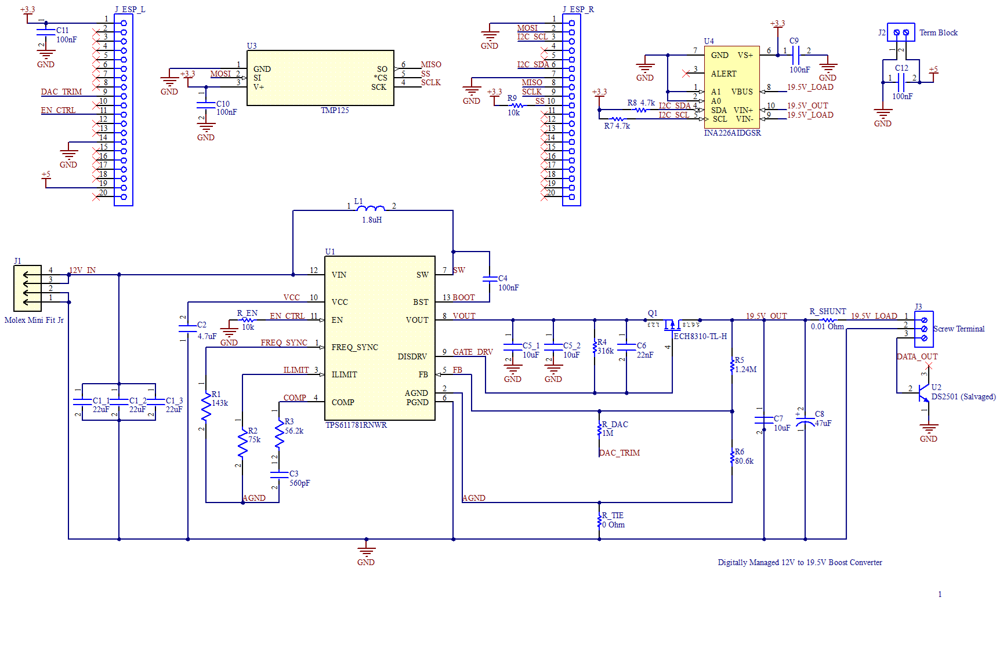

# Digitally Managed 12V to 19.5V (65W) Thin Client Boost Converter

-brightgreen)

A custom digitally managed DC-DC boost converter designed to step a **12V rail up to a stable 19.5V at 3.34A (65W)**. 

### Project Context
This board was designed for a custom Homelab setup containing multiple thin clients, hard drives, and single-board computers (SBCs) powered off a central 300W power supply (which provides 12V, 5V, and 3.3V rails). A **Dell OptiPlex 3050 Micro** thin client requires a **19.5V, 3.34A (65W)** input alongside Dell's 1-Wire adapter identification protocol. This board bridges the 12V homelab supply to the OptiPlex while adding ESP32-based telemetry, thermal monitoring, and dynamic output trimming.

---

## 3D PCB Renders

| Top View (3D) | Bottom View (3D) |
| :---: | :---: |
|  |  |

---

## Key Electrical Specifications & Calculations

| Parameter | Value | Notes / Design Details |
| :--- | :--- | :--- |
| **Input Voltage ($V_{IN}$)** | `12V DC` | Supplied via 4-pin Molex Mini-Fit Jr (`J1`), tested down to `11.4V` worst-case |
| **Output Voltage ($V_{OUT}$)** | `19.5V DC` | Set via `1.24 MΩ` / `80.6 kΩ` feedback divider ($V_{FB} = 1.19\text{V}$), trimmable via DAC |
| **Max Output Current ($I_{OUT}$)** | `3.34A` (`65W`) | Sized for Dell OptiPlex 3050 Micro peak load |
| **Switching Frequency ($f_{SW}$)** | `1.24 MHz` | Configured via $R_{freq}$ (`143 kΩ`) |
| **Peak Current Limit ($I_{LIMIT}$)** | `~10.39A` | Internal switch peak current limit set via $R_{limit}$ |
| **Inductor ($L_1$)** | `1.8 µH` | `2.27A` current ripple (~41% of `5.5A` average input current) |
| **Simulated Efficiency ($\eta$)** | `98.33%` | `62.64W` load power / `63.70W` input power at steady state |

---

## Hardware Architecture

| Block | Component | Interface & Function |
| :--- | :--- | :--- |
| **Boost Controller** | `TPS611781RNWR` (`U1`) | Synchronous boost converter with gate drive for external load-disconnect P-FET (`ECH8310-TL-H`) |
| **Power Monitor** | `INA226AIDGSR` (`U4`) | High-side I2C current/voltage/power monitor across a `10 mΩ` (`0.01 Ω`) shunt resistor |
| **Thermal Sensor** | `TMP125` (`U3`) | SPI temperature sensor placed near the switching hot loop for thermal monitoring |
| **Dell Adapter ID** | `DS2501` (`U2`) | Salvaged 1-Wire EPROM on the `DATA_OUT` line so the Dell thin client recognizes the 65W supply |
| **Digital Control** | ESP32 Headers (`J_ESP_L/R`) | Controls `EN_CTRL` (enable) and `DAC_TRIM` (voltage trimming via `1 MΩ` injection resistor) |

---

## Schematic

  

---

## 4-Layer PCB Stackup & Layout

To handle high switching currents (`1.24 MHz`) and ~`1W` of IC thermal dissipation while keeping sensitive analog feedback clean, the board uses a 4-layer stackup:

* **Layer 1 (Top Layer):** High-current power paths (`VIN`, `VOUT`, `SW`) routed using wide copper polygons to minimize parasitic inductance in the hot loop, plus primary components.
* **Layer 2 (Inner Plane 1):** Solid continuous Ground (`GND`) plane acting as both a thermal heatsink (via stitched thermal vias under `U1`) and an electromagnetic (EMI) shield.
* **Layer 3 (Inner Plane 2):** Secondary power routing (`EN_CTRL`, `19.5V` routing to load disconnect FET), with unused area filled with copper tied to `GND`.
* **Layer 4 (Bottom Layer):** Sensitive analog control signals (`COMP` network, `FREQ_SYNC`, `FB` node, and `DAC_TRIM`). Uses a dedicated Analog Ground (`AGND`) tied to Power Ground (`PGND`) at a single point (`R_TIE`).

> **Note:** Click the dropdown below to view the individual copper layer plots, or open the [full PCB Design PDF](assets/PCB%20Design.pdf).

<b>Click to expand 4-Layer Copper Plots</b>

 

| Layer 1 — Top Copper | Layer 2 — Ground Plane |
| :---: | :---: |
|  |  |

| Layer 3 — Secondary Power / GND | Layer 4 — Bottom Copper (Analog/Signals) |
| :---: | :---: |
|  |  |

---

## LTSpice Simulation Results

Prior to PCB layout, the circuit was validated in TI Power Designer and LTSpice across steady-state, idle, short-circuit, and dynamic load-step conditions:

| Simulation Test | Result |
| :--- | :--- |
| **Full-Load Steady State (`3.34A`)** | Smooth startup ramp to `19.5V` with a steady-state output ripple of `54 mV` (`0.054V`) |
| **Idle State (`50 mA` load)** | Stable `19.5V` regulation with minimal ripple during thin-client idle conditions |
| **Short-Circuit Protection (`0.01 Ω` load)** | Load disconnect and IC short-circuit protection trigger cleanly; output voltage and inductor current drop to `~0` |
| **Load Transient (`1.625A` to `3.25A` pulse)** | Output experiences a `0.5V` dip and recovers to steady-state `19.5V` within `0.15 ms` |
| **Steady-State Thermal Dissipation** | **IC (`TPS611781`):** `~1.03W` &nbsp;\|&nbsp; **Inductor (`L1`):** `~261 mW` &nbsp;\|&nbsp; **Load FET (`Q1`):** `~39.4 mW` |

---

## ESP32 Header Pinout Mapping

| Signal Name | Header | Pin Number | Function |
| :--- | :--- | :--- | :--- |
| `DAC_TRIM` | `J_ESP_L` | Pin 9 | Analog DAC output to trim feedback node (`R_DAC`) |
| `EN_CTRL` | `J_ESP_L` | Pin 11 | Digital Enable control for `TPS611781` |
| `MOSI` | `J_ESP_R` | Pin 2 | SPI MOSI for `TMP125` temperature sensor |
| `I2C_SCL` | `J_ESP_R` | Pin 3 | I2C Clock for `INA226` power monitor |
| `I2C_SDA` | `J_ESP_R` | Pin 6 | I2C Data for `INA226` power monitor |
| `MISO` | `J_ESP_R` | Pin 8 | SPI MISO for `TMP125` temperature sensor |
| `SCLK` | `J_ESP_R` | Pin 9 | SPI Clock for `TMP125` temperature sensor |
| `SS` | `J_ESP_R` | Pin 10 | SPI Chip Select for `TMP125` temperature sensor |

---

## Project Roadmap

- [x] Component selection, math modeling, and TI Power Designer compensation
- [x] LTSpice transient, short-circuit, and thermal dissipation simulations
- [x] Schematic capture and 4-layer PCB layout in Altium Designer
- [ ] Incorporate community DRC/layout feedback (`r/PrintedCircuitBoard`)
- [ ] Upload native Altium source files (`/hardware`) and fabrication Gerbers (`/production`)
- [ ] Assemble PCB and complete bench verification (oscilloscope ripple, transient, and thermal testing)